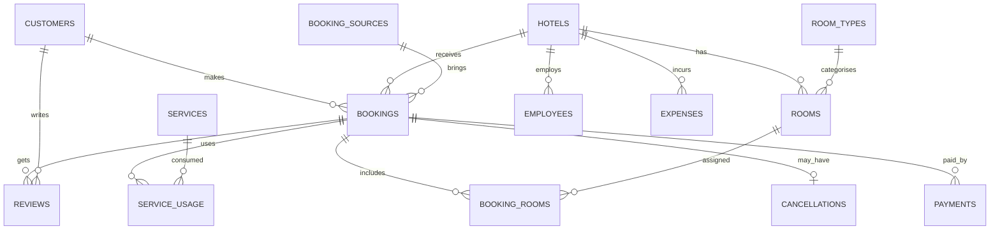

# Hotel-Booking-Revenue-Analytics
Hotel Booking and Revenue Analytics Dashboard using Power BI, SQL and CSV data.


#  Hotel Booking & Revenue Optimization (MySQL)

An end-to-end SQL analytics project built on a relational hotel-management database. It covers schema design, sample data loading, data-quality checks, and **15 business analysis questions** on revenue, cancellations, customer value, booking sources, room types, payments, services, expenses and overall hotel performance.


##  Project Overview

| Item | Details |
|---|---|
| **Database** | MySQL 8.0+ |
| **Database name** | `hotel_analytics` |
| **Script** | `hotel_analytics.sql` |
| **Domain** | Hospitality / Revenue Management |
| **Data period** | Jan 2025 – Jun 2025 (bookings made Jan–May 2025) |
| **Tables** | 15 |
| **Analysis queries** | 15 |

The goal is to answer questions a hotel group's management would ask: *Which hotel earns the most? Where are cancellations hurting us? Which booking channels are worth their commission? Who are our most valuable customers?*

---

##  Database Schema

### Tables

| # | Table | Description |
|---|---|---|
| 1 | `customers` | Guest profile, city, country, customer type (Regular / Premium) |
| 2 | `hotels` | Hotel master: city, star rating, type, total rooms, opening date |
| 3 | `room_types` | Standard, Deluxe, Suite, Family Room, Executive with base price & capacity |
| 4 | `rooms` | Individual rooms per hotel (unique `hotel_id + room_number`) |
| 5 | `bookings` | Booking header: dates, guests, status, total & discount amount |
| 6 | `booking_rooms` | Rooms assigned to each booking with nightly rate |
| 7 | `payments` | Payment method, amount, status (Paid / Pending / Refunded) |
| 8 | `cancellations` | Cancellation date, reason, refund amount |
| 9 | `reviews` | Customer rating (1–5) and review text |
| 10 | `services` | Add-on services (Breakfast, Spa, Laundry, Airport Transfer, Room Service) |
| 11 | `service_usage` | Services consumed per booking with quantity and cost |
| 12 | `employees` | Staff per hotel: title, department, salary, status |
| 13 | `expenses` | Monthly operating expenses by category |
| 14 | `marketing_campaigns` | Campaign name, channel, duration, budget |
| 15 | `booking_sources` | Hotel Website, Mobile App, Booking.com, MakeMyTrip, Travel Agent + commission % |

### Entity Relationship Diagram



> `marketing_campaigns` is a standalone reference table (not linked to bookings).

---

##  Sample Dataset Size

| Table | Rows |
|---|---|
| hotels | 5 |
| room_types | 5 |
| booking_sources | 5 |
| services | 5 |
| marketing_campaigns | 4 |
| customers | 20 |
| rooms | 25 |
| employees | 15 |
| bookings | 30 (25 Completed, 5 Cancelled) |
| booking_rooms | 30 |
| payments | 30 |
| cancellations | 5 |
| reviews | 20 |
| service_usage | 20 |
| expenses | 20 |

**Hotels covered:** Grand Palace Hotel (Mumbai), Sea View Resort (Goa), Royal Comfort Inn (Delhi), Mountain Escape (Manali), City Business Hotel (Bengaluru).

---

##  Business Questions Solved

| Q# | Analysis | Key SQL concepts |
|---|---|---|
| 1 | Comprehensive Hotel Revenue & Performance Report | 15+ CTEs, `LEFT JOIN`, `CASE`, `LAG`, `ROW_NUMBER`, KPI calculation |
| 2 | Hotel Profitability & Cancellation Risk | CTEs, conditional aggregation, risk classification |
| 3 | Revenue Trends & Month-over-Month Growth | `LAG()`, `DATE_FORMAT`, growth % |
| 4 | Booking Source & Marketing Channel Performance | Commission estimate, `DENSE_RANK()` |
| 5 | Customer Lifetime Value & Repeat Booking | CLV, customer segmentation, `DATEDIFF` |
| 6 | Room Type Revenue & Demand | Multi-table joins, `COUNT(DISTINCT)` |
| 7 | Cancellation & Refund Risk | `GROUP_CONCAT`, de-duplication with sub-queries |
| 8 | Customer Review & Satisfaction | Rating buckets, satisfaction levels |
| 9 | Operating Expenses & Cost Efficiency | Expense-to-revenue ratio |
| 10 | Booking Lead Time & Behavior | Lead-time bucketing (Last-Minute → Early) |
| 11 | Room Occupancy & Availability | Room utilization % |
| 12 | Payment Collection & Outstanding Revenue | Collection rate, pending vs refunded |
| 13 | Additional Services & Customer Spending | Service revenue ranking |
| 14 | Hotel-wise Performance Ranking & KPIs | `DENSE_RANK()`, composite KPI category |
| 15 | Final Hotel Business Performance Summary | Single-row executive summary with `CROSS JOIN` |

### KPIs Calculated

- Cancellation rate % and completion rate %
- Net booking revenue (`total_amount − discount_amount`)
- Payment collection %
- Estimated occupancy % and revenue per available room night
- Operating surplus proxy and margin %
- Average length of stay and booking lead time
- Month-over-month revenue growth %
- Customer lifetime value and value segment
- Commission cost by booking channel
- Average rating and satisfaction level

---

##  How to Run

1. Install **MySQL 8.0 or later** (window functions and CTEs are required).
2. Clone this repository:

   ```bash
   git clone https://github.com/<your-username>/<your-repo-name>.git
   cd <your-repo-name>
   ```

3. Run the script:

   ```bash
   mysql -u <username> -p < hotel_analytics.sql
   ```

   or open `hotel_analytics.sql` in MySQL Workbench and execute it section by section.

4. The script will:
   - create the `hotel_analytics` database,
   - create all 15 tables with primary keys, foreign keys and constraints,
   - insert the sample data,
   - run row-count and data-quality checks,
   - execute the 15 analysis queries.

>  Run each `QUESTION` block separately to view its result set.

---

##  Data Quality Checks Included

- Row count of every table (`UNION ALL` summary)
- Invalid date ranges (`check_out_date <= check_in_date`)
- Orphan bookings without a matching hotel
- Foreign key enforcement across all child tables

---

##  Tech Stack

- **MySQL 8.x**
- SQL: DDL, DML, joins, CTEs, window functions, aggregations, `CASE` logic, date functions, string aggregation

---

##  Notes & Assumptions

- Revenue metrics use **Completed** bookings only unless stated otherwise.
- "Operating surplus" is a **proxy** (revenue + service revenue − expenses), not audited profit.
- Estimated occupancy in Q1 assumes a 151-day window (1 Jan – 31 May 2025).
- Several analyses (Q2, Q6, Q9, Q11) link hotels to bookings through `rooms` and `booking_rooms`; Q12 and Q14 use `bookings.hotel_id` directly.
- Data is **synthetic** and meant for learning and portfolio use.

##  Possible Improvements

- Link `marketing_campaigns` to bookings to measure campaign ROI.
- Add indexes on frequently joined columns (`booking_id`, `hotel_id`, `customer_id`).
- Create views for the most used KPI reports.
- Connect the output to Power BI / Tableau for dashboards.
- Add stored procedures for monthly reporting.

---

##  Author

**Ayesha**
SQL | Data Analytics | Portfolio Project
